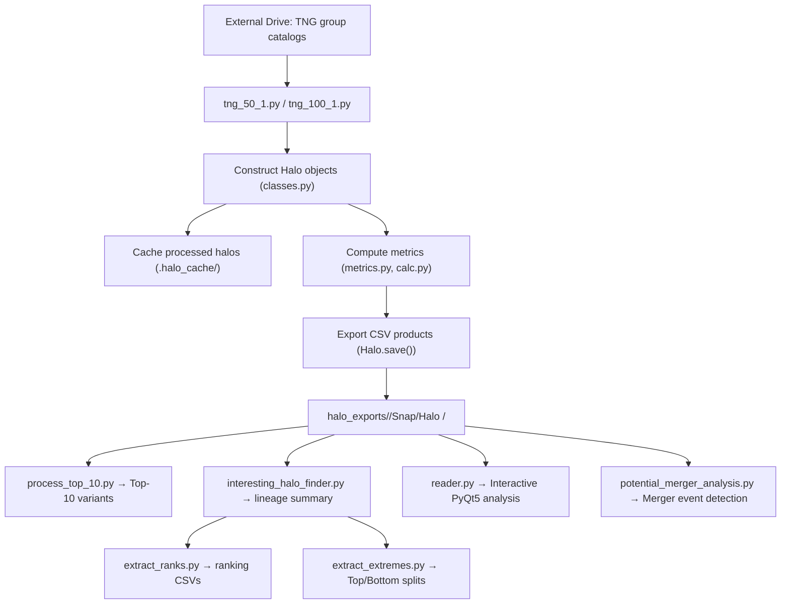

# Data Layout

## Code & Architecture Provenance Legend

To maintain clear academic and developmental transparency, modules, classes, and primary functions are cataloged with their origin attribution:

- **\[Human\]** : Conceived, authored, and validated entirely by the author.
- **\[AI-Assisted\]** : Conceptualized or drafted by human author with AI-assisted debugging, refactoring, or expansion.
- **\[AI-Developed\]** : Implemented via AI agent based on prompt instructions.

> *Note: Status tags are pre-populated as `[PENDING: Human | AI-Assisted | AI-Developed]` for final author review.*

---

## Project Root Structure

```
.
├── .halo_cache/              Pickled Halo objects (auto-managed by classes.py)
├── .p_val_cache/             Root-level isotropic null distribution cache (legacy)
├── halo_exports/             Exported halo-level CSV products
├── lopsidedness/             Local Python virtual environment
├── Writing/                  Thesis manuscript, reference papers, and figures
├── Documents/                Supplementary documentation
├── __pycache__/              Python bytecode cache
├── *.py                      Pipeline scripts and modules (see README.md)
├── README.md                 Repository overview
├── data_layout.md            This file
└── data_contract.md          Schema and validation contracts
```

---

## External Raw Simulation Data

Raw simulation data is stored on an external drive at:

```
D:\Abhilash_Thesis_Data\Simulation_Data\
```

### Source Structure

```
Simulation_Data/
├── TNG50-1/
│   ├── output/
│   │   ├── groups_068/       # Group catalog HDF5 files for Snapshot 68
│   │   ├── groups_069/
│   │   ├── ...
│   │   └── groups_099/       # Group catalog HDF5 files for Snapshot 99
│   └── postprocessing/
│       └── offsets/           # Offset files for SubLink merger tree access
└── TNG100-1/
    ├── output/
    │   ├── groups_068/
    │   ├── ...
    │   └── groups_099/
    └── postprocessing/
        └── offsets/
```

### Raw Data Components

#### `output/groups_0XX/`

Contains Illustris group catalog HDF5 files for each snapshot. Loaded via `illustris_python.groupcat.loadHalos()` and `loadSubhalos()`.

**Halo fields loaded**: `GroupCM`, `GroupPos`, `GroupFirstSub`, `GroupNsubs`, `GroupMass`, `Group_R_Crit200`

**Subhalo fields loaded**: `SubhaloFlag`, `SubhaloBHMdot`, `SubhaloPos`, `SubhaloParent`, `SubhaloGrNr`, `SubhaloMass`, `SubhaloStellarPhotometrics`, `SubhaloStarMetalFractions`, `SubhaloVel`

#### `postprocessing/offsets/`

Contains offset files required by `illustris_python` for SubLink merger tree traversal. Used by `Halo.analyze_merger_history()` and `Halo._are_related()` for progenitor/descendant lineage queries.

---

## Execution Scripts `[PENDING: Human | AI-Assisted | AI-Developed]`

The following files act as pipeline entry points for data generation:

| Script | Simulation | Provenance |
|:-------|:-----------|:-----------|
| `tng_50_1.py` | TNG50-1 | `[PENDING: Human \| AI-Assisted \| AI-Developed]` |
| `tng_100_1.py` | TNG100-1 | `[PENDING: Human \| AI-Assisted \| AI-Developed]` |

**Responsibilities:**

1. Load raw simulation data from external drive via `illustris_python`
2. Construct `Halo` objects using `classes.py`
3. Apply halo-selection criteria (GroupMass range: 50–500; Central_Galaxy_Mass range: 50–300)
4. Apply satellite membership via `Halo.get_subhalos_by_volume()` with periodic boundary correction
5. Compute metrics through `Halo.calc_metrics()`
6. Trigger export through `Halo.save()` with per-product flags

These scripts orchestrate the pipeline but should not contain reusable analysis logic.

---

## Export Structure

Processed halo data is exported under:

```
halo_exports/
├── TNG100-1/
│   ├── .p_val_cache/                              # Isotropic null distribution pickle cache
│   ├── interesting_systems/                       # Case-study figures (full population)
│   │   ├── Halo943/
│   │   ├── Halo1429/
│   │   └── Halo1639/
│   ├── interesting_systems_top_10/                # Case-study figures (Top-10 regime)
│   │   ├── Halo575/
│   │   ├── Halo847/
│   │   ├── Halo1185/
│   │   └── Halo1507/
│   ├── merger_plots/                              # Merger analysis output figures
│   ├── metrics_overview_plots/                    # Population overview exported PNGs
│   ├── Snap68/                                    # Per-snapshot export folders
│   │   ├── Halo 1000/                             # Per-halo data folders
│   │   │   ├── sim_TNG100-1_halo_1000_snap_68_positions.csv
│   │   │   ├── sim_TNG100-1_halo_1000_snap_68_positions_top_10.csv
│   │   │   ├── sim_TNG100-1_halo_1000_snap_68_dark_positions.csv
│   │   │   ├── sim_TNG100-1_halo_1000_snap_68_metrics.csv
│   │   │   ├── sim_TNG100-1_halo_1000_snap_68_metrics_top_10.csv
│   │   │   ├── sim_TNG100-1_halo_1000_snap_68_all_tracks.csv
│   │   │   ├── sim_TNG100-1_halo_1000_snap_68_all_tracks_top_10.csv
│   │   │   ├── sim_TNG100-1_halo_1000_snap_68_central_ids.csv
│   │   │   ├── sim_TNG100-1_halo_1000_snap_68_metric_evolution.csv
│   │   │   ├── sim_TNG100-1_halo_1000_snap_68_metric_evolution_top_10.csv
│   │   │   ├── sim_TNG100-1_halo_1000_snap_68_merger_history.csv
│   │   │   └── sim_TNG100-1_halo_1000_snap_68_magnitude_gap.csv
│   │   └── Halo 1001/ ...
│   ├── Snap69/ ... Snap99/
│   ├── halo_lineage_summary.csv                   # Master lineage tracking file
│   ├── system_ranks_snap99.csv                    # Full-population metric rankings
│   ├── system_ranks_snap99_top_10.csv             # Top-10 regime metric rankings
│   ├── top_bottom_5_systems_snap99.csv            # Extreme Top/Bottom 5 halo IDs
│   ├── top_bottom_5_systems_snap99_top_10.csv     # Extreme Top/Bottom 5 (Top-10 regime)
│   ├── top_10_systems.csv                         # Summary of Top-10 processed systems
│   └── Top_Bottom_Systems_Snap99_Metrics_*.csv    # Timestamped Top/Bottom splits
└── TNG50-1/
    └── (same structure as TNG100-1)
```

---

## Per-Halo Exported File Types

Each `Halo <ID>/` folder under `Snap<XX>/` contains the following file variants:

### Core Files (Generated by `Halo.save()`)

| File Pattern | Description | Generator |
|:-------------|:------------|:----------|
| `*_positions.csv` | Visible-subhalo positions relative to central, plus subhalo properties | `Halo.save(save_subhalo_pos=True)` |
| `*_dark_positions.csv` | Dark-subhalo positions relative to central | `Halo.save(save_dark_subhalo=True)` |
| `*_metrics.csv` | Scalar halo-level properties and lopsidedness metric values | `Halo.save(save_metrics=True)` |
| `*_all_tracks.csv` | Time-history positions for tracked visible satellites | `Halo.save(save_tracks=True)` |
| `*_central_ids.csv` | Central subhalo identity and reference-frame metadata across snapshots | `Halo.save(save_central_ids=True)` |
| `*_metric_evolution.csv` | Temporal evolution of lopsidedness metrics | `Halo.save(save_metric_evolution_using_tracks=True)` |

### Top-10 Variants (Generated by `Halo.save(save_top_10=True)` or `process_top_10.py`)

| File Pattern | Description |
|:-------------|:------------|
| `*_positions_top_10.csv` | Positions of the 10 most massive luminous satellites + central |
| `*_metrics_top_10.csv` | Metrics computed solely from the Top-10 satellite subset |
| `*_all_tracks_top_10.csv` | Track histories for the Top-10 satellite cohort |
| `*_metric_evolution_top_10.csv` | Metric evolution for the Top-10 tracked cohort |

### Merger Analysis Files (Generated by `Halo.save(save_merger_analysis=True)`)

| File Pattern | Description |
|:-------------|:------------|
| `*_merger_history.csv` | Per-snapshot merger classification (Stable/Infall/Fly-by/Loss) |
| `*_magnitude_gap.csv` | Per-snapshot magnitude gap (Δm₁₂) between central and secondary |

---

## Summary & Ranking CSV Products

Generated at the simulation root level (e.g., `halo_exports/TNG100-1/`):

| File | Generator | Description |
|:-----|:----------|:------------|
| `halo_lineage_summary.csv` | `interesting_halo_finder.py` | Master tracking: HaloID, SubfindID, export status per snapshot; index = `HaloID_at_Snap99` |
| `system_ranks_snap99.csv` | `extract_ranks.py` | Per-metric ranking of all Snap99 halos (Rank 1 = most lopsided) |
| `system_ranks_snap99_top_10.csv` | `extract_ranks.py --top_10` | Same for Top-10 regime (≥ 10 satellites only) |
| `top_bottom_5_systems_snap99.csv` | `extract_extremes.py` | 5 most and 5 least lopsided halo IDs per metric |
| `top_bottom_5_systems_snap99_top_10.csv` | `extract_extremes.py --top_10` | Same for Top-10 regime |
| `top_10_systems_summary.csv` | `generate_top10_list.py` | Summary of which halos have been Top-10 processed |

---

## File Naming Convention

### Standard Pattern

```
sim_<Simulation>_halo_<HaloID>_snap_<Snapshot>_<type>.csv
```

**Examples:**
- `sim_TNG100-1_halo_552_snap_99_metrics.csv`
- `sim_TNG100-1_halo_552_snap_99_positions.csv`
- `sim_TNG100-1_halo_552_snap_99_all_tracks.csv`
- `sim_TNG100-1_halo_552_snap_99_dark_positions.csv`
- `sim_TNG100-1_halo_552_snap_99_central_ids.csv`
- `sim_TNG100-1_halo_552_snap_99_metric_evolution.csv`
- `sim_TNG100-1_halo_552_snap_99_merger_history.csv`
- `sim_TNG100-1_halo_552_snap_99_magnitude_gap.csv`

### Top-10 Variant Pattern

```
sim_<Simulation>_halo_<HaloID>_snap_<Snapshot>_<type>_top_10.csv
```

**Examples:**
- `sim_TNG100-1_halo_552_snap_99_positions_top_10.csv`
- `sim_TNG100-1_halo_552_snap_99_metrics_top_10.csv`
- `sim_TNG100-1_halo_552_snap_99_all_tracks_top_10.csv`
- `sim_TNG100-1_halo_552_snap_99_metric_evolution_top_10.csv`

---

## Naming Conventions

| Entity | Convention |
|:-------|:----------|
| Simulation names | `TNG100-1`, `TNG50-1` |
| Raw group-catalog folders | `groups_068` ... `groups_099` |
| Export snapshot folders | `Snap68` ... `Snap99` |
| Per-halo folders | `Halo <ID>` (space-separated, e.g., `Halo 552`) |

---

## Workflow


